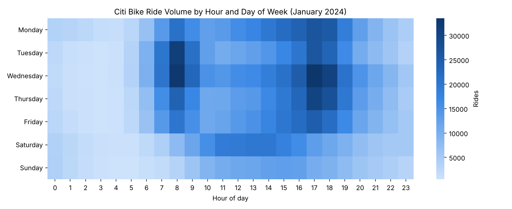

# NYC Citi Bike 2024: where bikes are needed, and when

An end-to-end analysis of **<!--fact:total_rides-->?<!--/fact--> Citi Bike trips** (all of 2024), joined to
NOAA weather and NYC's bike lane network, built around an operator's question:
where do bikes pile up and run out, and can tomorrow's demand be predicted
station by station?

**[View the live site](https://ancientabacus.github.io/NYC-CitiBike-Analysis/)** ·
**[2024 notebook](CitiBike_2024.ipynb)**



## Key findings

- **The commute leaves about <!--fact:bikes_to_move-->?<!--/fact--> bikes in the wrong place every weekday morning.**
  <!--fact:drainer_count-->?<!--/fact--> stations lose 2+ bikes each morning and <!--fact:filler_count-->?<!--/fact--> gain 2+. Brooklyn
  loses ~<!--fact:brooklyn_am_loss-->?<!--/fact--> bikes a morning and Manhattan's office districts absorb them. The
  evening rush reverses it (correlation <!--fact:am_pm_corr_normalized-->?<!--/fact--> after adjusting for station size).
- **Rain hurts most at rush hour.** Holding temperature, weekday and growth fixed, rain during
  commute hours cuts a day's rides by <!--fact:commute_rain_effect-->?<!--/fact--> (95% CI <!--fact:commute_rain_ci-->?<!--/fact-->),
  rain only outside commute hours by <!--fact:offpeak_rain_effect-->?<!--/fact--> (<!--fact:offpeak_rain_ci-->?<!--/fact-->).
- **Demand is forecastable a day ahead, honestly measured.** Station × hour models for departures
  and arrivals, trained on Jan–Oct and scored on unseen Nov–Dec, cut error by
  <!--fact:forecast_vs_7d-->?<!--/fact--> against the *strongest* simple rule (the same hour's 7-day average, which is
  also the model's top input), and by <!--fact:forecast_vs_naive-->?<!--/fact--> against "same hour last week". The gain
  held in <!--fact:backtest_wins-->?<!--/fact--> of <!--fact:backtest_folds-->?<!--/fact--> monthly rolling backtests.
- **Where it doesn't help:** at picking each morning's <!--fact:net_top_k-->?<!--/fact--> biggest bike-losing stations,
  the model (<!--fact:net_precision_model-->?<!--/fact-->/<!--fact:net_top_k-->?<!--/fact-->) is no better than last week's average
  (<!--fact:net_precision_7d-->?<!--/fact-->/<!--fact:net_top_k-->?<!--/fact-->); those stations are the same every day.

## What's in the repo

| Path | What it does |
|---|---|
| [`docs/index.html`](docs/index.html) | The site: heatmap, seasons & weather, ridership maps, rebalancing map, forecast evaluation, and a written report. Plain HTML/SVG/JS charts ([`docs/assets/charts.js`](docs/assets/charts.js)), Leaflet maps. |
| [`CitiBike_2024.ipynb`](CitiBike_2024.ipynb) | Walkthrough of the 2024 analysis: cleaning, weather model, rebalancing, forecast evaluation. |
| [`CitiBike_Analysis.ipynb`](CitiBike_Analysis.ipynb) | Exploratory deep-dive on January 2024, including a member-vs-casual classifier and the class-imbalance accuracy trap. |
| [`scripts/pipeline.py`](scripts/pipeline.py) | Single source of truth for loading, cleaning (with per-rule stats), the parquet cache, and NOAA weather. |
| [`scripts/build_*.py`](scripts/) | One script per site section: heatmap, maps, seasonality, rebalancing, forecast. |
| [`scripts/sync_facts.py`](scripts/sync_facts.py) | Every number in the site's prose and this README is tagged with the fact it states and checked against the data in CI. |
| [`tests/`](tests/) | Unit tests for cleaning, flows, intervals, geometry; consistency tests across the published data. |

## Method notes

- **Cleaning** (`pipeline.py`): drop duplicate rides, out-of-month spillover, trips missing
  station or coordinates, non-positive durations, and trips over 24h. Removes
  <!--fact:removed_share-->?<!--/fact--> of <!--fact:raw_rows-->?<!--/fact--> raw rows. Every section reads the same cleaned trips.
- **Weather model:** log-linear model of daily rides with rain split by *when* it fell (hourly
  NOAA data), temperature controls and a growth trend; 95% intervals from a 14-day block
  bootstrap because daily ridership is autocorrelated.
- **Forecast evaluation** is strictly by date: train Jan 8–Aug, early-stop on Sep–Oct, refit on
  Jan–Oct, test Nov–Dec, plus a rolling monthly backtest (Aug–Dec). Every feature is known a day
  ahead. A day-of-year feature was tried and removed: with a date split, test dates are values
  the trees never saw, and validation error rose as trees were added. Prediction intervals are
  split-conformal (calibrated on Sep–Oct); test coverage of the 80% band was
  <!--fact:interval_coverage-->?<!--/fact-->.
- **Limitations:** observed (not forecast) weather; no dock capacity in the trip data, so
  "bikes to move" is a lower bound; one year of data.

## Data sources

- Trips: [Citi Bike System Data](https://citibikenyc.com/system-data) (monthly zips on S3)
- Weather: [NOAA NCEI](https://www.ncei.noaa.gov/), Central Park station (hourly LCD + GHCN-Daily)
- Bike lanes and borough boundaries: [NYC Open Data](https://opendata.cityofnewyork.us/)

Nothing is committed; everything downloads into a gitignored `.cache/` on first run.

## Reproducing

```bash
pip install -r requirements-dev.txt
```

Each script takes a period, `YYYY` (default `2024`) or `YYYYMM`. Run in this order (the first run
downloads ~7.5 GB of trip data; the forecast takes ~45 minutes and ~8 GB RAM on 4 cores):

```bash
python scripts/build_heatmap.py
```

```bash
python scripts/build_geomap.py
```

```bash
python scripts/build_seasonality.py
```

```bash
python scripts/build_rebalancing.py
```

```bash
python scripts/build_forecast.py
```

Then refresh the numbers quoted in the prose and run the checks:

```bash
python scripts/sync_facts.py --write
```

```bash
python -m pytest -q
```

## Deployment

`.github/workflows/jekyll-gh-pages.yml` deploys `docs/` to GitHub Pages on every push to `main`;
`.github/workflows/checks.yml` runs lint, the fact check and the tests on every push.
